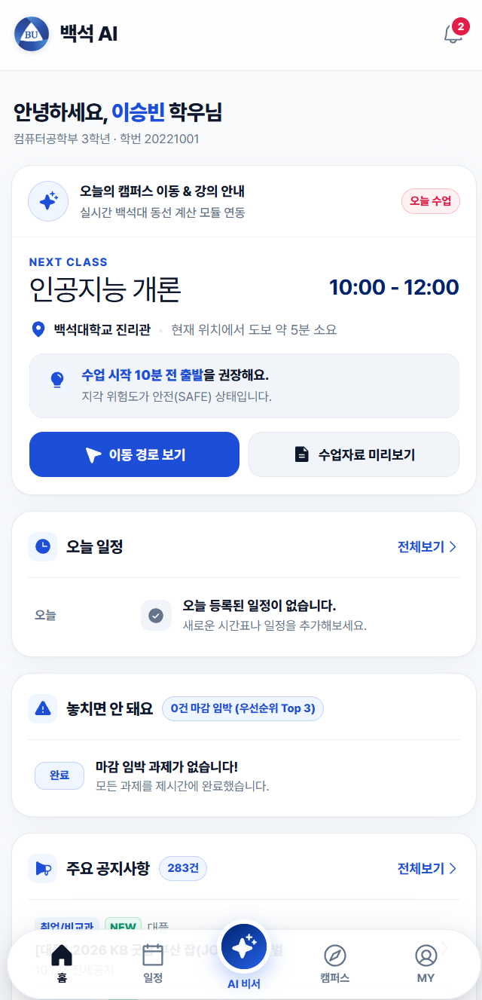

# Lazy Guy

### A beginner-first starter kit for AI coding agents.

Build, fix, and preview your web app with one task prompt at a time.

Lazy Guy gives your AI coding tool a shared set of project rules, task prompts, and documentation workflows.
That way you spend less time figuring out what to ask next.

Works with Cursor, Codex, Claude Code, and Antigravity.
See [tool support](#tool-support) for setup details and limitations.

[Get started](#quick-start)
·
[Example project](#example-project)
·
[Task prompts](#task-prompts)
·
[Full setup](#connect-services-optional)

---

## Why Lazy Guy?

Opening an AI coding tool is easy.
Knowing what to do next is harder.

- What should I ask to build a page?
- How do I connect the frontend and backend?
- What should I paste when something breaks?
- How do I run the project and see the result?
- How do teammates keep the same project conventions?

Lazy Guy provides a starting point for each of these tasks.

It is not a new AI model or a replacement for your coding tool.
It is a reusable project structure that helps you work with one.

## Who is it for?

- Beginners who can describe an idea but do not know how to turn it into development tasks
- People trying AI coding tools for the first time
- Small teams that want shared rules, feature specs, and work notes

You do not need to know every framework before starting.
You should still review generated code, check the result, and approve sensitive changes.

---

## Example project

**BU_Team** is a full collaboration project.
People built it together using the **Lazy Guy** workflow as the shared basis for the whole site and repository.



| Explore | Link |
|---------|------|
| Live website | [bu-team.netlify.app](https://bu-team.netlify.app/) |
| Source code | [azure-B/BU_Team](https://github.com/azure-B/BU_Team) |

It is a university-oriented web app with a React + Vite frontend, an Express backend, project docs, and deploy config.

Names and IDs on the demo screen are sample data.

Use BU_Team as a concrete reference for a Lazy Guy–style team workflow.
It is not a promise that every agent run will produce the same result.

---

## What is included?

| Part | What it helps with |
|------|--------------------|
| Task prompts A–H | Start setup, frontend, backend, database, Python, full-stack, debugging, or preview tasks |
| Shared agent instructions | Give supported tools a common entry point through `AGENTS.md` and `CLAUDE.md` |
| Project rules | Define conventions for code structure, documentation, and development workflows |
| Feature specs and work notes | Keep a record of what is being built and what changed |
| Error-recovery prompt | Give the agent your error and context through `G-fix.md` |
| Local preview helper | Start the local app through `H-preview.md` and `scripts/dev-up.mjs` |

These files guide the agent.
They do not guarantee that every change will be correct.

---

## Quick start

Start by previewing the local starter app.
No MCP keys or cloud-service tokens are required for this path.

### 1. Prepare your tools

Install:

- Node.js **18+** (20 LTS recommended) and npm
- One AI coding tool: Cursor, Codex, Claude Code, or Antigravity

Need app-specific instructions?
See the [AI tool setup guide](.AI/docs/13-ide-setup.md).

### 2. Get the project

Clone the repository:

```bash
git clone https://github.com/azure-B/Lazy_guy.git
cd Lazy_guy
```

Or download the ZIP from GitHub, extract it, and open the extracted folder in your AI coding tool.

### 3. Ask the agent to preview it

Attach [`.AI/prompts/H-preview.md`](.AI/prompts/H-preview.md), or paste:

```text
Read .AI/prompts/H-preview.md and follow it.

Show me the starter app in the browser.
I am a beginner.

Page route: /
I need API too: yes

Check whether the servers are already running before starting them.
```

The agent should use the preview workflow to install dependencies if needed and start the local servers.

You can also run this yourself:

```bash
node scripts/dev-up.mjs
```

Open a URL only when the helper reports that service as **READY**.
If a port is taken by another app, `dev-up` fails for that service instead of pretending Lazy Guy is already running.

### 4. Open the local app

Use the URL returned by your agent.
The default addresses are:

| Service | Default URL |
|---------|-------------|
| Frontend | http://localhost:5173 |
| Backend health check | http://localhost:3001/api/health |

Local preview does not require MCP keys, a cloud database, or Git pull.

If something fails on your machine, use [G-fix](.AI/prompts/G-fix.md) or see [QUICKSTART.md](QUICKSTART.md).

### 5. Make your first change

Attach [`.AI/prompts/B-front.md`](.AI/prompts/B-front.md), or paste:

```text
Read .AI/prompts/B-front.md and follow it.

I am a beginner.
Create a simple homepage for a university club.

Include:
- A welcome section
- A list of upcoming events
- A contact section

Use placeholder content.
Do not connect a database or external service yet.
```

Then use `H-preview.md` again to see the result.

For the complete walkthrough, see [QUICKSTART.md](QUICKSTART.md).

---

## If something breaks

You do not need to diagnose the error before asking for help.

Attach [`.AI/prompts/G-fix.md`](.AI/prompts/G-fix.md), or paste:

```text
Read .AI/prompts/G-fix.md and follow it.

I am a beginner. Help me fix this problem.

What I was trying to do:
[Describe the action.]

What happened:
[Describe what you saw.]

Full error message:
[Paste the error here. Remove tokens, passwords, and other secrets.]

Explain what changed and how I can check the result.
```

Review the proposed changes and check the app again.

Some problems may take more than one attempt to resolve.

---

## Task prompts

Choose one prompt for the task you want to do.

| Prompt | Use it for |
|--------|------------|
| [A — MCP setup](.AI/prompts/A-mcp.md) | Connecting supported external tools |
| [B — Frontend](.AI/prompts/B-front.md) | Building or changing React screens |
| [C — Backend](.AI/prompts/C-back.md) | Building or changing Express APIs |
| [D — Database](.AI/prompts/D-db.md) | Database changes and ERD updates |
| [E — Python](.AI/prompts/E-python.md) | Python scripts and data-processing tasks |
| [F — Full stack](.AI/prompts/F-fullstack.md) | Features that need both a screen and an API |
| [G — Fix](.AI/prompts/G-fix.md) | Debugging errors and unexpected behavior |
| [H — Preview](.AI/prompts/H-preview.md) | Running the app and viewing the result |

If your tool supports file mentions, attach the prompt with `@`.

Otherwise, start your request with:

```text
Read .AI/prompts/B-front.md and follow it.
```

Replace the filename with the prompt you need.

### Everyday workflow

```text
1. Choose a task prompt
2. Describe what you want
3. Review the changes
4. Preview with H
5. If something breaks, use G
```

Database writes and schema changes require your permission under the project rules.

Review the proposed changes before approving them.

---

## Connect services (optional)

You can explore the local starter before connecting cloud services.

Use the full setup when you need repository tools, a cloud database, or deployment integrations.

| Service | Purpose | Required for local preview? |
|---------|---------|-----------------------------|
| GitHub MCP | Repository-related tools for the agent | No |
| Supabase | Cloud database and related integrations | No |
| Netlify | Frontend hosting and deployment tools | No |
| Render | Backend hosting and deployment tools | No |

Start here:

- [Full setup checklist](QUICKSTART.md#2-full-setup--mcp-and-cloud-services)
- [Detailed MCP setup guide](.AI/docs/09-mcp-setup.md)

### Credential handling

The setup workflow uses:

```text
MCPkeys.json.example
  → copy and fill locally
MCPkeys.json
  → register
node scripts/register-mcp.mjs
```

After successful registration, the script deletes the temporary root-level `MCPkeys.json`.

This does not remove credentials written to `.cursor/mcp.json`.
It also does not revoke them in the connected services.

Never commit filled credential files.
Do not share secrets in prompts, screenshots, or error reports.

The registration script currently targets Cursor's MCP configuration.
Other tools may require their own MCP setup.

---

## Tool support

Setup guidance is included for:

| Tool | Where to start |
|------|----------------|
| Cursor | `AGENTS.md`, `.cursor/rules/` |
| Codex | `AGENTS.md` |
| Claude Code | `CLAUDE.md` |
| Antigravity | Point project rules at `AGENTS.md` |

Step-by-step: [AI tool setup guide](.AI/docs/13-ide-setup.md).

End-to-end behavior has **not** been verified across every tool, OS, and version.

Having setup docs is not the same as a full compatibility test.

---

## How the project stays organized

The shared instructions ask agents to:

- Create or update a feature spec before implementation
- Follow the frontend and backend structure
- Update API documentation and work notes after relevant changes
- Keep the folder map current when files are added, moved, or removed
- Ask for permission before database writes or schema changes
- Check for existing local servers before starting new ones

These are workflow instructions, not automatic enforcement.

Review diffs and verify important behavior yourself.

| Location | Purpose |
|----------|---------|
| `AGENTS.md` / `CLAUDE.md` | Agent entry points |
| `.AI/prompts/` | Task prompts A–H |
| `.AI/docs/` | Detailed project rules |
| `.AI/md/` | Feature specs, API notes, and work logs |
| `front/` | Frontend project |
| `back/` | Backend project |
| `python/` | Python workspace |
| `scripts/` | Setup and development helpers |
| `Folder.md` | Project folder map |

---

## Requirements and limitations

### Requirements

- One supported AI coding tool
- Node.js **18+** (20 LTS recommended) and npm for the local frontend and backend
- Additional accounts or credentials only for the integrations you choose to use

### Costs

Lazy Guy does not include AI-tool subscriptions, hosting, or cloud-service credits.

Your chosen tools and services may have paid plans, usage limits, or changing free-tier conditions.

Check their terms before connecting them.

### Limitations

- AI agents can misunderstand instructions or generate incorrect code.
- Project rules do not replace testing, security review, or backups.
- Tool-specific setup and behavior can differ.
- Local preview success does not imply production readiness.

### License

License selection is still pending.

Ask the maintainer before redistributing.

---

## Documentation

| Guide | Purpose |
|-------|---------|
| [Quickstart](QUICKSTART.md) | Start locally and learn the daily workflow |
| [AI tool setup](.AI/docs/13-ide-setup.md) | Configure your chosen coding tool |
| [Task prompts](.AI/prompts/) | Choose a prompt for your task |
| [Project rules](.AI/docs/) | Read the detailed development conventions |
| [MCP setup](.AI/docs/09-mcp-setup.md) | Connect external tools |
| [Agent instructions](AGENTS.md) | Read the shared agent entry point |
| [Folder map](Folder.md) | Explore the repository structure |
| [Environment example](env_example) | Review hosting and environment configuration |

---

## Questions and feedback

Found a confusing step or a reproducible problem?
Open an issue with:

- Your AI coding tool
- Your operating system
- What you tried
- What happened
- Relevant error output, with secrets removed

You can also contact the maintainer at [benefit5758@naver.com](mailto:benefit5758@naver.com).

If Lazy Guy helps you get started, consider giving it a star.
